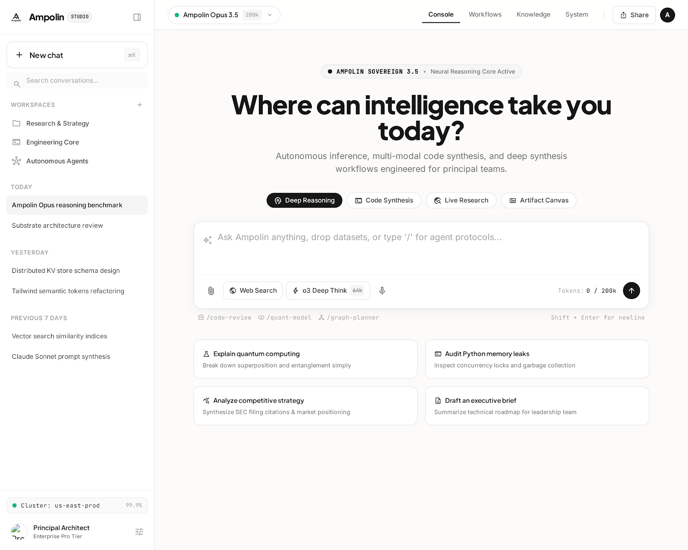

# Ampolin AI — Autonomous Agent Studio

An autonomous, multi-modal coding agent and studio interface built with an editorial **Monochrome Minimalist** design system.



---

## Features

* **Multi-Tier AI Routing**:
  * **Groq Cloud**: Lightning-fast inference via `openai/gpt-oss-120b` and `qwen/qwen3.8-27b`.
  * **Google Gemini**: Deep reasoning and vision via `gemini-3.5-flash-lite` and `gemini-3.8-flash`.
  * **n8n Workflow Engine**: Automated agent tool calling and webhook orchestration.
  * **Ollama Offline**: Local offline fallback when disconnected from the internet.
* **Dual Device Views**:
  * **Desktop Studio** (`index.html`): Multi-pane workspace with command palette, model selector, and dynamic chat stream.
  * **Mobile Native App** (`mobile.html`): Safe-area compliant iOS/Android view with bottom-sheet model drawer and pill composer.
* **Zero-Cost Operation**: Runs entirely on free tiers (Groq free tier + Google AI Studio free tier).

---

## Quick Start (Local)

1. Clone repository:
   ```bash
   git clone https://github.com/kaustuv-Vector1/Ampolin_ai.git
   cd Ampolin_ai
   ```

2. Install dependencies:
   ```bash
   npm install
   ```

3. Create `.env` file from `.env.example`:
   ```env
   GEMINI_API_KEY=your_gemini_key
   GROQ_API_KEY=your_groq_key
   PORT=3005
   ```

4. Run:
   ```bash
   npm start
   # or double-click start-ampolin.bat
   ```
   Open `http://localhost:3005` in your browser.

---

## 24/7 Cloud Automation with n8n

* To run local n8n with cloud webhook tunnel:
  ```bash
  npm run n8n:tunnel
  # or double-click start-n8n-tunnel.bat
  ```
* Import the pre-configured workflow from `ampolin-n8n-workflow.json` into n8n.
